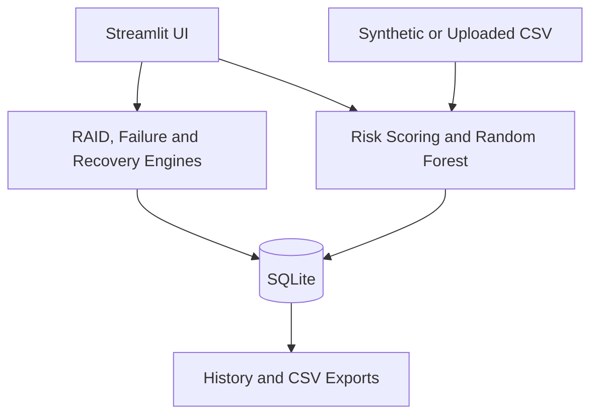

# RAID Intelligence — Storage Monitoring & Recovery

Virtual storage environment for monitoring disk health, analyzing failure risk, managing RAID 5 state transitions, and reviewing recovery activity. It uses heuristic risk scoring, a Random Forest model, SQLite history, and CSV exports. It does not access physical storage devices or guarantee real-world failure prediction.

## Windows / VS Code
```powershell
cd raid-failure-prediction-simulator
py -m venv .venv
.venv\Scripts\activate
python -m pip install --upgrade pip
pip install -r requirements.txt
python -m pytest -q
streamlit run app.py
```
Use `python` instead of `py` if the Python launcher is unavailable. Streamlit normally opens `http://localhost:8501`.

## Linux/macOS
```bash
cd raid-failure-prediction-simulator
python3 -m venv .venv
source .venv/bin/activate
pip install -r requirements.txt
python -m pytest -q
streamlit run app.py
```

## Pages
Command Center; Disk Simulator; Disk Health; Failure Risk Analysis; RAID Array Management; Recovery Operations; Analytics & History; Model & Dataset; System Information. The Disk Simulator lets users select virtual disks, edit telemetry, simulate read/write workloads and gradual wear, recalculate risk, and inject a failure. The dashboard includes a visual RAID topology, disk cards, risk chart, event log, and recovery workflow.

## RAID 5
Four 500 GB disks provide approximately 1500 GB usable capacity. One failed member puts RAID 5 in degraded mode; two failed members make data inaccessible in this simplified model. A replacement must be at least as large as the failed disk. A successful rebuild does not repair the original failed drive.

## CSV dataset schema
`temperature_c,reallocated_sectors,pending_sectors,uncorrectable_errors,read_error_count,write_error_count,power_on_hours,latency_ms,failure_label`
The synthetic label is derived from health indicators plus noise. It is demonstration data, not real-world evidence.

Generate a dataset with `python scripts/generate_dataset.py --rows 1200 --output data/sample_disk_data.csv`. Train with `python scripts/train_model.py`. Test with `python -m pytest -q`.

## Operating workflow
1. Open Command Center and review RAID capacity.
2. Use Disk Health Monitoring to create a high-risk disk.
3. Run heuristic prediction.
4. Inject one disk failure and show DEGRADED.
5. Open Recovery Center, create a replacement of at least 500 GB.
6. Advance rebuild in 10% increments until complete.
7. Inspect Analytics and History.
8. Reset before repeating.

## Architecture


## Troubleshooting
- Import errors: run commands from the project root.
- Missing Streamlit: activate `.venv`, then install requirements.
- Port busy: `streamlit run app.py --server.port 8502`.
- Training failure: dataset must include all schema columns, non-negative numeric features and both label classes.
- Rebuild rejected: replacement capacity must meet or exceed failed disk capacity; a second failed disk prevents rebuild.

## Limitations and future work
All telemetry and recovery are simulated. Scores are heuristic indicators, not calibrated probabilities. Synthetic training results do not establish real-world accuracy. RAID is not a backup. Future work includes real SMART datasets, calibrated models, more RAID levels, and configurable rebuild bandwidth.
